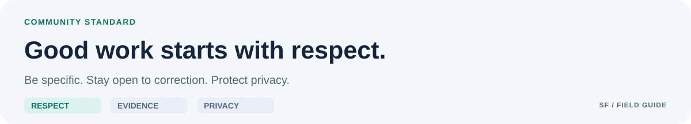

<picture>
  <source media="(prefers-color-scheme: dark) and (max-width: 700px)" srcset="docs/assets/github/conduct-mobile-dark.svg">
  <source media="(max-width: 700px)" srcset="docs/assets/github/conduct-mobile-light.svg">
  <source media="(prefers-color-scheme: dark)" srcset="docs/assets/github/conduct-dark.svg">
  
</picture>

# Community conduct

Be respectful, specific, and open to correction. Critique designs and behavior rather than people. Support claims with evidence and acknowledge uncertainty.

Harassment, discrimination, threats, doxxing, deliberate deception, and sharing private information without permission are unacceptable in project spaces.

The maintainer may request edits, moderate content, restrict participation, or remove access proportionately. Explain decisions privately where appropriate and protect reporters' privacy.

Use GitHub's private abuse-reporting facilities for sensitive reports. Request an additional private channel without posting personal details if needed. Do not disclose sensitive conduct reports or vulnerabilities in public issues.
