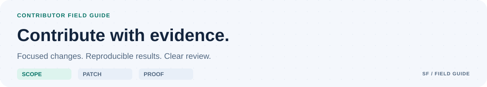

<picture>
  <source media="(prefers-color-scheme: dark) and (max-width: 700px)" srcset="docs/assets/github/contributing-mobile-dark.svg">
  <source media="(max-width: 700px)" srcset="docs/assets/github/contributing-mobile-light.svg">
  <source media="(prefers-color-scheme: dark)" srcset="docs/assets/github/contributing-dark.svg">
  
</picture>

# Contributing

The project has an experimental local fixture core. Runtime and dashboard work follow [the bounded milestones](docs/IMPLEMENTATION_PLAN.md); a design is not an implemented control. See the [qualification record](docs/milestones/PHASE_1_QUALIFICATION.md) for executed results and current limits.

## Scope the work

| Step | Bring to review |
| --- | --- |
| Scope | A concrete problem, current ownership, and bounded acceptance criteria |
| Change | A focused diff with explicit compatibility and authority impact |
| Prove | Reproducible checks tied to the exact source snapshot |
| Review | Honest gaps, clear decisions, and a concrete delivery preview |

Read [AGENTS.md](AGENTS.md), the relevant design, existing issues/PRs, and nested instructions. Propose material scope, protocol, trust-boundary, dependency, or model-routing changes before implementation. Check current ownership. Small corrections can go directly to a focused PR.

Preserve unrelated changes and workspaces. Keep private data, credentials, transcripts, and local factory state out of commits and issues. Use synthetic fixtures. Discuss vulnerabilities through [the private process](SECURITY.md).

## Commits and PRs

Use Conventional Commit subjects: `type(scope): outcome`, with optional scope and `!` for breaking changes. Types: `feat`, `fix`, `docs`, `refactor`, `perf`, `test`, `build`, `ci`, `chore`, `revert`. Subjects are at most 100 characters. Describe a concrete result; use a `BREAKING CHANGE:` footer for a breaking contract or migration.

PR titles follow the same convention and become the squash-merge subject. Reviewers assess the final diff and evidence. Explain the problem, result, decisions, exact validation, and gaps using the PR template. Do not add generated-by or unsolicited co-author trailers.

Apply an appropriate type label and relevant area/status labels from [the catalog](.github/labels.json). Breaking changes also receive `breaking-change`. Labels do not waive checks.

## Foundation checks

The shared toolchain selects exact CPython 3.15.2 and PyYAML 6.0.3 through [toolchain.json](toolchain.json). The explicit Python qualification recipe builds a pure wheel from verified sources and pinned build dependencies in two independent trees, with a fixed epoch and permission mask. Its bytes must match the canonical hash shared with [.github/requirements-ci.txt](.github/requirements-ci.txt). The local wheel is not a published PyPI wheel.

With the qualified environment available:

```sh
python3 scripts/check_repository.py
python3 -m unittest discover -s tests -p 'test_*.py'
```

These check repository policy, local document links, forms/configuration, workflow invariants, vendored assets, and tooling regressions. The core has separate strict build, fixture, process recovery and dependency checks; see [the local core commands](docs/LOCAL_CORE.md). CI additionally uses pinned actionlint, zizmor, and Gitleaks. See [CI.md](docs/CI.md).

Follow the operator's resource and installation constraints. Do not install tools or start services merely to satisfy this document. Record a blocked check when its environment is unavailable.

## Review and delivery

### Visual documentation

The README and field-guide artwork share a tokenized SVG source in `scripts/generate_docs_assets.py`. It produces separate light/dark and mobile/desktop layouts with embedded, pinned Lobe Icons marks. No font service or browser script is needed to display the artwork.

```sh
python3 scripts/generate_docs_assets.py
python3 scripts/generate_docs_assets.py --check
```

Check GitHub-rendered Markdown, both themes, and narrow layouts when changing the design. Preserve text alternatives and the third-party notices. Foundation CI rejects stale artwork or missing image/theme-source paths.

### Evidence and publication

Failed, missing, stale, skipped, or canceled required checks block readiness. Tie evidence to the current snapshot and distinguish executed checks from reviewed reports. Review workflow, dependency, policy, and runner changes as security-sensitive code. New behavior needs tests that discriminate it from plausible wrong behavior; trivial docs edits do not need implementation-mirroring tests.

Changes to `main` use a PR and required checks. [GOVERNANCE.md](GOVERNANCE.md) explains the solo-maintainer profile. Agent-created pushes, PRs, external messages, and releases each need operator approval for the concrete action. Do not enable auto-merge, posting, or publishing through a contribution.

Contributions are provided under Apache-2.0. Retain third-party notices and record the origin and permitted use of imported material.
