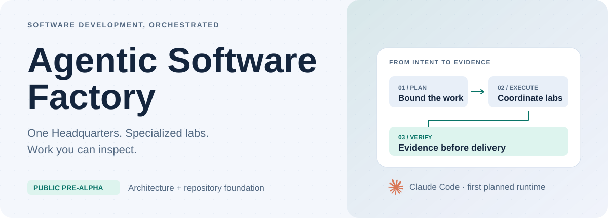
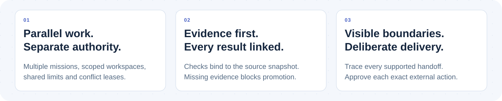
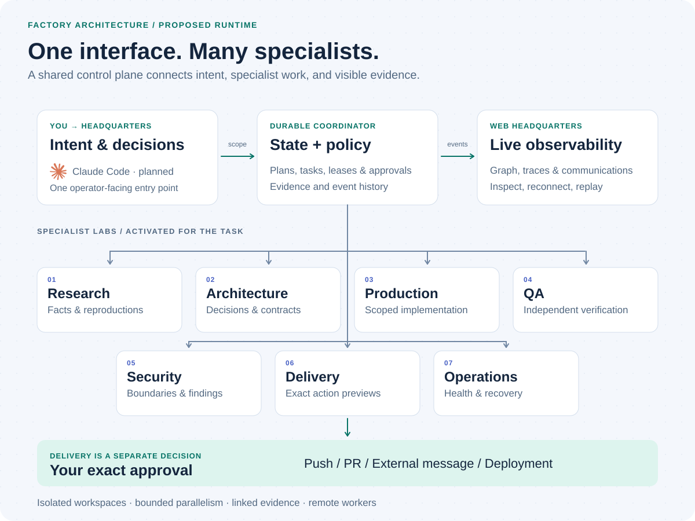
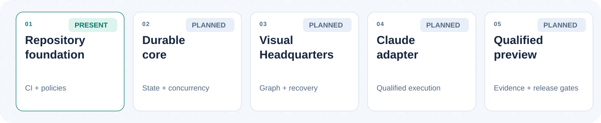

<picture>
  <source media="(prefers-color-scheme: dark) and (max-width: 700px)" srcset="docs/assets/github/hero-mobile-dark.svg">
  <source media="(max-width: 700px)" srcset="docs/assets/github/hero-mobile-light.svg">
  <source media="(prefers-color-scheme: dark)" srcset="docs/assets/github/hero-dark.svg">
  
</picture>

  <a href="docs/ARCHITECTURE.md"><strong>Architecture</strong></a> &nbsp;·&nbsp;
  <a href="docs/DASHBOARD.md"><strong>Live Headquarters</strong></a> &nbsp;·&nbsp;
  <a href="docs/IMPLEMENTATION_PLAN.md"><strong>Roadmap</strong></a> &nbsp;·&nbsp;
  <a href="CONTRIBUTING.md"><strong>Contribute</strong></a>

  
  
  

A generic, agentic software factory being built around **one operator-facing Headquarters**. Specialized labs will coordinate research, design, implementation, independent verification, and delivery preparation. OSS contributions are the first mode; the core is designed for software work beyond OSS.

> [!WARNING]
> **Public pre-alpha.** A local simulated core is implemented and qualified within its recorded fixture scope. The dashboard, live worker adapter, process isolation and remote execution remain **unimplemented or unqualified**. There is no supported installation or unattended execution mode. Do not provide production credentials or workloads.

## Work you can follow. Authority you can inspect.

<picture>
  <source media="(prefers-color-scheme: dark) and (max-width: 700px)" srcset="docs/assets/github/principles-mobile-dark.svg">
  <source media="(max-width: 700px)" srcset="docs/assets/github/principles-mobile-light.svg">
  <source media="(prefers-color-scheme: dark)" srcset="docs/assets/github/principles-dark.svg">
  
</picture>

These are the operating requirements we are building toward. Multiple missions and compatible subtasks will share bounded resources while keeping plans, workspaces, messages, evidence, and approvals separate. Canceling one mission must leave the others progressing. [Concurrency contract →](docs/CONCURRENCY.md)

## Inside the factory

<picture>
  <source media="(prefers-color-scheme: dark) and (max-width: 700px)" srcset="docs/assets/github/architecture-mobile-dark.svg">
  <source media="(max-width: 700px)" srcset="docs/assets/github/architecture-mobile-light.svg">
  <source media="(prefers-color-scheme: dark)" srcset="docs/assets/github/architecture-dark.svg">
  
</picture>

**Proposed runtime architecture.** Labs are capabilities activated for a task, with parallel execution where safe. They are not eight permanently running processes. The web graph, traces, communications, and evidence inspectors will follow one durable event history, including work on remote machines.

<strong>Read the architecture in text</strong>

1. **Headquarters** turns an objective into a bounded plan for your approval.
2. **The coordinator** owns task state, authority, resource leases, evidence references, and event history.
3. **Specialist labs** exchange scoped tasks, findings, questions, and rework through the broker.
4. **Independent QA and Security** evaluate the relevant acceptance and trust boundaries. Missing or failed required evidence blocks promotion.
5. **The web Headquarters** shows the same managed work as a graph, trace, task list, communication ledger, and replayable history.
6. **Delivery** prepares an exact preview. Every push, PR, external message, and deployment requires a distinct approval; delegation cannot expand authority.

See the [architecture](docs/ARCHITECTURE.md), [verification requirements](docs/VERIFICATION.md), and [remote protocol](docs/DASHBOARD.md).

## An honest roadmap

<picture>
  <source media="(prefers-color-scheme: dark) and (max-width: 700px)" srcset="docs/assets/github/roadmap-mobile-dark.svg">
  <source media="(max-width: 700px)" srcset="docs/assets/github/roadmap-mobile-light.svg">
  <source media="(prefers-color-scheme: dark)" srcset="docs/assets/github/roadmap-dark.svg">
  
</picture>

**Today:** repository foundation plus an experimental TypeScript coordinator, transactional SQLite ledger, scoped approvals, bounded concurrent scheduling, evidence gates and a foreground fixture CLI. A real process restart demonstration is available locally. **Still ahead:** hosted core CI qualification, the web application, live runtime adapter, isolated execution and supported releases. Each milestone has [measurable exit criteria](docs/IMPLEMENTATION_PLAN.md).

The proposed CI extension adds core quality, core qualification and full dependency review to foundation checks. Hosted execution of this extension is pending publication approval. Foundation checks cover source/configuration, tooling regressions, workflow security, secrets and static analysis. A green foundation check does not establish runtime safety, agent correctness, or production readiness. [CI scope →](docs/CI.md)

## The first runtime, deliberately scoped

<table>
<tr>
<td width="80" align="center"></td>
<td><strong>Claude Code · first planned adapter</strong> Native agents, skills, and qualified execution interfaces. Choose models from the operator's authorized inventory and resource limits. Runtime behavior still needs local and remote qualification.</td>
</tr>
</table>

The proposed web stack is **React + TypeScript**, with **React Flow + ELK** for the graph and a persistent **Node/Fastify** coordinator backed by a transactional **SQLite** ledger. [Stack decisions and qualification →](docs/TECH_STACK.md)

## Explore. Challenge. Contribute.

| Understand the system | Help build it |
| --- | --- |
| [Charter & operating boundaries](docs/CHARTER.md) | [Contributor field guide](CONTRIBUTING.md) |
| [Web Headquarters & remote observability](docs/DASHBOARD.md) | [Development instructions](AGENTS.md) |
| [Evidence & authority](docs/VERIFICATION.md) | [Governance & review](GOVERNANCE.md) |
| [Dated platform research](docs/PLATFORM_RESEARCH.md) | [Release qualification](RELEASING.md) |

Use issue forms for reproducible bugs, bounded proposals, and design questions. Discuss security findings through the [private reporting policy](SECURITY.md). We value concrete requirements, readable work, and evidence that survives review.

---

  
   
  Provider marks by <a href="https://github.com/lobehub/lobe-icons"><strong>Lobe Icons</strong></a> · <a href="docs/assets/lobe/SOURCES.json">Pinned source</a> · <a href="docs/assets/lobe/LICENSE">MIT notice</a>
   
  Original project material: <a href="LICENSE">Apache-2.0</a> · <a href="NOTICE">Third-party notices</a>

Brand names and icons identify planned integrations and do not imply endorsement.
