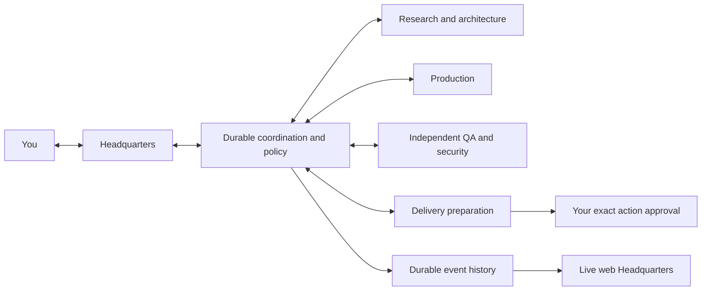

# Agentic Software Factory

**One Headquarters. Specialized labs. Observable work. Human-approved delivery.**

[Architecture](docs/ARCHITECTURE.md) · [Live graph](docs/DASHBOARD.md) · [Roadmap](docs/IMPLEMENTATION_PLAN.md) · [Contributing](CONTRIBUTING.md)

**Pre-alpha · Repository foundation · Apache-2.0**

> [!WARNING]
> This project is under active design. The factory runtime, dashboard, worker isolation, and approval enforcement are **not implemented or qualified**. There is no supported installation or unattended execution mode yet. Do not give this project production credentials or workloads.

Agentic Software Factory is a generic development organization you operate through Headquarters. Its planned labs research, design, implement, independently verify, and prepare delivery inside an approved scope. Open-source contributions are the first mode; the core is intended to support other software work.

## Intended workflow

An approved plan permits bounded local work on the designated execution machines. Each push, PR, external message, and deployment needs a separate approval. Internal delegation cannot expand authority.

The web application will connect machines, labs, tasks, attempts, model/tool calls, communications, approvals, and evidence. The graph, waterfall, history, and inspectors will share one event projection. A disconnected viewer will show its last observation and replay missed events after reconnecting.

Multiple missions and compatible tasks are intended to run concurrently, with separate plans, workspaces, evidence, and approvals under shared resource limits. Conflicting writes and delivery targets must coordinate. See [concurrency requirements](docs/CONCURRENCY.md).

## What exists today

| Area | Current state |
| --- | --- |
| Architecture, lab responsibilities, remote protocol, stack | Design proposals |
| Repository policies, templates, audit tooling, CI definitions | Foundation source; qualification status is recorded separately |
| Coordinator, dashboard, runtime adapter, isolated workers | Not implemented |
| Live end-to-end runs and production qualification | Not performed |
| Releases and published packages | None |

CI checks the repository foundation. A green foundation check does not establish runtime safety, agent correctness, or production readiness. See [CI scope and qualification](docs/CI.md).

## Planned stack

React and TypeScript for the web application; React Flow and ELK for the live graph; a persistent Node/Fastify coordinator; a transactional SQLite ledger; resumable event transport; and a native Claude Code adapter. Details and remaining qualification are in the [stack proposal](docs/TECH_STACK.md).

 **Claude Code is the first planned runtime.** Model selection will use the operator's authorized model inventory and resource limits. Other runtimes are future adapter decisions.

## Explore the design

- [Charter](docs/CHARTER.md): purpose, authority, and operating boundaries.
- [Architecture](docs/ARCHITECTURE.md): labs, durable coordination, adapters, and modes.
- [Web application and remote observability](docs/DASHBOARD.md): live graph, cross-machine tracing, replay, and controls.
- [Verification](docs/VERIFICATION.md): evidence, trust boundaries, approvals, and recovery.
- [Roadmap](docs/IMPLEMENTATION_PLAN.md): milestones with measurable exit criteria.
- [Platform research](docs/PLATFORM_RESEARCH.md): dated findings and unqualified behavior.

## Contribute

Start with [CONTRIBUTING.md](CONTRIBUTING.md), [AGENTS.md](AGENTS.md), and the current milestone. Propose material architecture or authority changes before implementation. Claims of verified behavior need evidence tied to the exact source snapshot.

Use the issue forms for bugs, proposals, and design questions. Report vulnerabilities privately as described in [SECURITY.md](SECURITY.md). Responsibilities and release criteria are in [GOVERNANCE.md](GOVERNANCE.md) and [RELEASING.md](RELEASING.md).

## License and icon credits

Original project material is licensed under [Apache-2.0](LICENSE). Third-party assets retain their licenses; see [NOTICE](NOTICE).

 AI/provider icons come from [Lobe Icons](https://github.com/lobehub/lobe-icons). Vendored assets include their [MIT license and pinned provenance](docs/assets/lobe/SOURCES.json). Brand names and icons identify integrations and do not imply endorsement.
