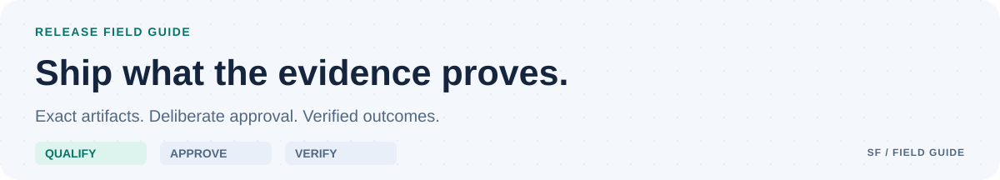

<picture>
  <source media="(prefers-color-scheme: dark) and (max-width: 700px)" srcset="docs/assets/github/releasing-mobile-dark.svg">
  <source media="(max-width: 700px)" srcset="docs/assets/github/releasing-mobile-light.svg">
  <source media="(prefers-color-scheme: dark)" srcset="docs/assets/github/releasing-dark.svg">
  
</picture>

# Release policy

There are no releases or publishable runtime artifacts. Public development and warnings do not substitute for qualification.

## Preparation

Use Semantic Versioning for artifacts. Begin previews with a prerelease such as `0.1.0-alpha.1`; disclose breaking changes and migrations even before 1.0. Versions and notes describe the shipped tree. Do not publish placeholder packages.

Prepare a release-readiness issue and PR with the exact commit, scope, environment matrix, executed evidence, dependency/license review, limitations, migration/recovery notes, and release-note draft. [.github/release.yml](.github/release.yml) categorizes draft notes; review them before publication.

## First executable release gate

| Gate | Required evidence |
| --- | --- |
| Qualification | Behavior, trust boundaries, recovery, and supported environments |
| Artifact integrity | Clean build, SBOM, notices, digests, verified provenance |
| Authorization | Exact destination, source revision, payload, and artifact approval |
| Outcome | Installation, remote contents, and rollback/stop verification |

- Build and test the exact commit with frozen dependencies in a clean, qualified environment.
- Demonstrate acceptance, authority boundaries, isolation, cancellation, crash/restart, reconnect, stale approval rejection, and missing-evidence failure behavior relevant to the supported features.
- Produce an SBOM, notices, artifact digests, and build provenance bound to those digests. Verify provenance and installation/use of the produced artifact.
- Use scoped short-lived credentials/OIDC where supported. Restrict them to reviewed release jobs and a protected, qualified human approval path. Untrusted PR jobs cannot access them.
- Document migration/backup and tested rollback/stop procedures. Resolve relevant vulnerabilities or record justified, owned, expiring exceptions.

Implement and qualify the release workflow and artifact checks before the first executable release. Current foundation CI does not provide them.

## Publication

Approve each push, release/PR/message, package publication, and deployment separately for its destination, exact commit/payload, artifact digests, and expected state. A tag or green build is not approval. Reconcile uncertain outcomes before retrying.

After approval, create the version/tag, publish the reviewed artifacts, and verify remote versions, hashes, provenance, and contents. Record the result. Correct defects through an advisory, replacement version, or explicit revocation; do not silently move version tags.
