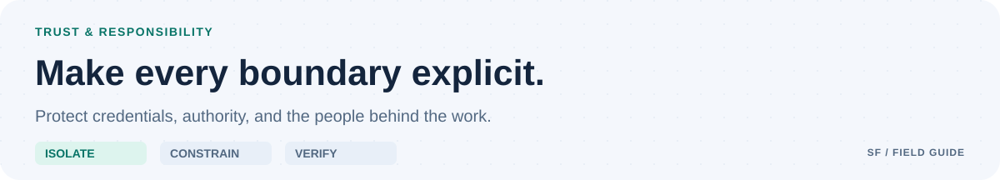

<picture>
  <source media="(prefers-color-scheme: dark) and (max-width: 700px)" srcset="docs/assets/github/security-mobile-dark.svg">
  <source media="(max-width: 700px)" srcset="docs/assets/github/security-mobile-light.svg">
  <source media="(prefers-color-scheme: dark)" srcset="docs/assets/github/security-dark.svg">
  
</picture>

# Security policy

## Support

There are no supported runtime releases. This is pre-alpha foundation/design source. Isolation, credential separation, approval enforcement, and remote recovery await implementation and adversarial qualification. Do not use it for unattended production changes.

## Private reporting

Use **Security → Report a vulnerability** when enabled. Include the revision, synthetic reproduction, impact, relevant environment, and suggested mitigation. Do not include live secrets, private source, or real user data.

If private reporting is unavailable, do not post vulnerability details publicly. Request that the maintainer establish a private channel without disclosing the flaw. No private email address is assumed.

There is no staffed response-time guarantee. The maintainer coordinates reproduction, remediation, affected-version assessment, and disclosure when practical. Credential incidents require rotation/revocation and exposure assessment; deleting a secret does not undo exposure.

## Boundaries

| Boundary | Requirement |
| --- | --- |
| Worker → host | Qualified filesystem, process, network, and resource isolation |
| Worker → control plane | No access to protected approvals, delivery credentials, or audit records |
| Result → readiness | Exact-snapshot evidence and independent required checks |
| Readiness → publication | A distinct approval for the exact external action |

Treat target repositories, scripts, model output, messages, logs, and artifacts as untrusted. Keep approval authority, delivery credentials, and audit records outside worker-writable paths. Use synthetic data and qualified isolation. A worktree or tool allowlist alone is not a sandbox.

Security-sensitive changes need review and regression evidence. See [verification requirements](docs/VERIFICATION.md) and [CI trust boundaries](docs/CI.md). Scanner success does not waive a confirmed finding.
