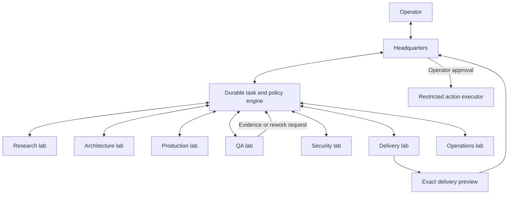

# Architecture proposal

Status: design, not an implemented system.

## Organization



Labs are capabilities with defined contracts, not eight permanent processes. Activate the specialists needed for a task. A small documentation correction should not incur the workflow and model cost of a security-sensitive release.

| Lab | Accountable for | Handoff | Authority boundary |
| --- | --- | --- | --- |
| Headquarters | Intent, scope, planning, budget, operator communication, final synthesis | Approved plan and task graph | Cannot invent operator approval or override failed required gates |
| Research | Source-backed facts, reproductions, dependency and repository conventions, ownership/overlap checks | Research dossier with claims, evidence, uncertainties, recommendation | Read-only by default; experiments need an approved bounded environment |
| Architecture | Design alternatives, interfaces, migration and compatibility decisions, verification strategy | Design decision and acceptance mapping | Cannot expand product scope or approve its own material plan revision |
| Production | Scoped implementation, developer checks, documentation | Patch, implementation explanation, developer evidence | Edits allocated paths/workspace; no external credentials |
| QA | Independent requirement tests, integration/E2E behavior, regressions, evidence audit | Verification result and reproducible rework tasks | Does not approve its own implementation or silently waive required checks |
| Security | Trust boundaries, dependency/code execution risks, relevant security tests | Findings, mitigations, security gate where required | Cannot broaden the worker's access to complete a check |
| Delivery | Final diff review, upstream process, accurate PR/release text, exact action preparation | Delivery bundle for Headquarters | Preparing a mutation does not authorize executing it |
| Operations | Run health, resource limits, recovery, audit retention, measured improvements | Health/recovery events and improvement proposals | Cannot silently change permissions, prompts, or routing policy during a run |

Every lab gets an `AGENTS.md`, a role definition, scoped skills, explicit inputs/outputs, and capability limits. A shared factory protocol describes the organization and communication contract. Role-specific expertise is loaded only when needed. Nested experts are useful for substantial independent subtasks, with depth, concurrency, and budget limits.

## Durable coordination

Use a small runtime-neutral core for tasks, dependencies, approvals, evidence, policy checks, leases, and audit events. Suggested first implementation: a local TypeScript CLI with a transactional SQLite store and content-addressed artifacts. This technology choice remains part of plan review; no dependencies have been installed.

The detailed [technology stack proposal](TECH_STACK.md) covers the web application, gateway, shared contracts, graph, storage, and verification tooling. Its library choices still require compatibility and boundary qualification before implementation claims.

Claude Code native workflows or sessions can execute work. They do not replace the factory's authoritative ledger. Native session IDs are execution references, not factory task identity. Conversation summaries and agent memory are caches of facts, not approval records.

Proposed task progression:

```text
intake -> plan_review -> research -> design_if_needed -> production
       -> independent_verification -> delivery_review -> awaiting_action_approval
       -> action_execution -> post_action_verification -> complete
```

Rework returns to a specific task with failed acceptance criteria and evidence. A task may be blocked, canceled, or inconclusive. A failed command, absent evidence, or skipped required check cannot be promoted to success.

The approved plan defines the allowed transitions and optional stages. Research can lead to a no-change conclusion, or return a contradicted premise to Headquarters. Build the graph around the work rather than forcing every task through an identical sequence.

### Task and message envelope

Persist: run ID, task ID, parent ID, sender/recipient lab, message type, correlation ID, idempotency key, approved plan revision/hash, target repository and snapshot, assigned paths, required capabilities, dependencies, acceptance criteria, evidence references, resource reservation, attempt limit, lease/version, and current status.

Message types include task request, accepted/declined, question, finding, artifact ready, rework request, blocked, and completed. Receiver identity and task ownership come from the engine, not from text claiming to be another lab. Cross-lab requests use the same broker and policy checks as Headquarters dispatch.

Delivery is at least once; consumers deduplicate. State transitions use transactions and compare-and-swap versions. Claim leases have an expiry and heartbeat. Cap rework, nesting, task fan-out, and total budgets; repeated failure returns to Headquarters with evidence. Do not replay an external mutation simply because the caller timed out.

## Runtime adapters

Multiple missions and parallel tasks share a bounded scheduler. Keep per-mission authority, workspaces, budgets, and evidence separate while enforcing global/host/provider limits. Serialize conflicting workspace and delivery-target writes; cancel only owned work. [CONCURRENCY.md](CONCURRENCY.md) defines scheduling, lease/fencing, fairness, cross-mission isolation, and required failure scenarios.

Execution location and conversation location are independent. One designated coordinator owns each factory ledger. A web dashboard and the Headquarters Claude client connect to that coordinator; trusted worker supervisors can execute on other machines. The coordinator can share a remote machine with the first worker, while remaining outside worker-writable paths. Do not share a SQLite database over a network filesystem or give two coordinators concurrent authority. See [the dashboard and remote protocol](DASHBOARD.md).

Define a narrow adapter contract: discover capabilities; resolve a model; start/resume/cancel an attempt; stream events; return structured output, usage, and artifacts. Record unsupported capabilities and fail the task when a required capability is absent.

The first adapter packages native Claude Code agents and skills as a plugin within the operator's authenticated Claude Code environment and invokes supported session/workflow interfaces. The selected access path is the operator's Claude Code subscription; an API key is not required by this proposal. Do not extract OAuth credentials or offer the subscription's login/rate limits as a hosted third-party service. Capability probing is read-only and version-aware. Prefer native orchestration when it provides the required behavior. Agent teams remain an optional experimental path, not the sole reliability foundation. Research and verification must test the actual installed runtime.

Keep lab definitions, plans, evidence formats, and mode logic independent of Claude-only configuration. Later adapters can target other coding agents without rewriting the factory's state machine or authority policy. Do not claim adapter support until its contract tests and live qualification pass.

## Live state and tracing

The coordinator commits each authoritative state transition and its event in one transaction. A transactional outbox drives a resumable, ordered dashboard stream. Runtime diagnostics, worker observations, and trusted evidence receipts retain distinct provenance. Worker event spools survive interrupted transport; event IDs and producer sequence numbers support deduplication and gap detection. A worker's report cannot mint an approval or replace independently collected evidence.

Use a first-party web Headquarters with a graph, trace waterfall, communications ledger, evidence inspector, and approval inbox. Suggested stack: the TypeScript core, SQLite on the coordinator's local disk, a React interface, and React Flow with ELK layout. This remains a proposal. Use SSE for the browser's live feed and authenticated command requests for controls. An SSH tunnel is the first remote access path; the interface must not depend on Claude Desktop forwarding its port automatically.

OpenTelemetry is an optional diagnostic/export interface. Native runtime telemetry augments the authoritative event journal; it does not replace it. Record telemetry coverage and last observation per machine, adapter, and attempt. Trace metadata can be live while content remains redacted. Detailed behavior, topology, and acceptance criteria are specified in [DASHBOARD.md](DASHBOARD.md).

## Model selection

Route by requirements rather than choosing a model permanently for a job title:

| Work | Starting profile | Escalate when |
| --- | --- | --- |
| Bounded extraction or inventory normalization | Fast, inexpensive | Ambiguous data, conflicting facts, or consequential interpretation |
| Routine implementation and targeted tests | General coding | Repeated failures, architectural uncertainty, concurrency, numerical correctness, or security-sensitive changes |
| Hard design, diagnosis, or adversarial review | Deep reasoning | Available capability or evidence remains insufficient; return a limitation instead of cycling forever |

Claude Code aliases can seed profiles (`haiku`, `sonnet`, `opus`, `best`), subject to verified availability and the operator's authorized subscription usage. Select only from eligible models; do not enable paid extra usage or switch billing paths without authorization. Resolve and record the actual model ID and settings on every attempt. Pin a qualified model for a run when supported. A silent fallback must not weaken a required capability. A model upgrade or policy change can require requalification.

Selection considers quality results from representative tasks, latency, context needs, provider restrictions, privacy, and remaining budget. Do not fabricate dollar costs for subscription runs: report tokens, turns, time, and provider-reported usage where available. Budget reservations precede dispatch; account for child attempts and overshoot.

## Modes

The core owns authority, state, execution boundaries, and evidence integrity. A mode supplies domain-specific stages, skills, acceptance templates, and delivery preparation. Modes cannot grant new privileges.

OSS mode adds current issue/PR availability checks, contributor ownership, repository instruction discovery, upstream process/approval gates, baseline reproduction, a focused patch, upstream-prescribed checks, and accurate public drafts. Refresh availability at selection, implementation start, and before delivery. A private application feature mode would use the same core without GitHub issue-hunt assumptions.

## Proposed source layout

```text
labs/<lab>/AGENTS.md              # accountable role contracts
skills/<capability>/SKILL.md      # reusable expertise and workflows
core/                            # durable tasks, policy, approvals, evidence
dashboard/                       # Headquarters graph, trace, evidence, controls
transport/                       # resumable viewer feed and worker protocol
adapters/claude-code/             # native plugin/session/workflow integration
modes/oss-contribution/           # first domain mode
schemas/                         # versioned boundary contracts
evals/                           # behavioral fixtures and failure scenarios
docs/                            # decisions, operator guide, maturity evidence
```

Generate runtime packaging from canonical role/skill sources where useful. Keep generated files traceable and validate that the native loader actually applies their fields. Do not create empty directories or duplicate instructions simply to match this sketch.
