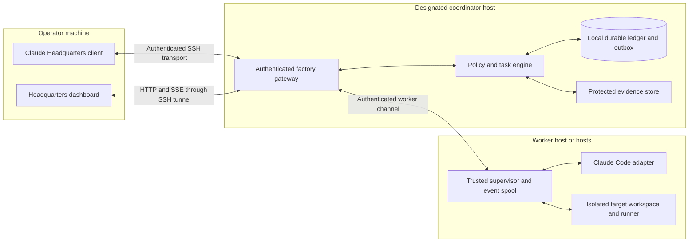

# Live Headquarters and remote execution

Status: architecture proposal, revised 29 October 2026. No dashboard server, remote connection, worker, or telemetry collector has been started. Interface previews use fictional fixture data.

## Product contract

The dashboard is a core part of the first usable factory release. The operator talks to Headquarters and can inspect the entire managed workflow without relaying messages between labs. Conversation, visualization, and execution can be on different machines. The same interface supports a single laptop or a coordinator with remote workers.

“Fully traced” means every supported execution boundary produces a durable, correlated record. It does not mean access to a model's private reasoning, visibility through an offline network, or automatic instrumentation of arbitrary unmanaged Claude sessions. The adapter declares coverage; a required missing capability blocks a strict-audit run. Partial coverage stays visible rather than being presented as complete.

## Deployment topology



Start with one remote coordinator colocated with one worker supervisor, in separate trust boundaries. A local run uses the same components through loopback. The coordinator owns the authoritative ledger on its local disk; never share SQLite over a network filesystem. Workers have scoped identities and submit observations through the gateway, with no write access to approval records or delivery credentials.

The first remote viewing path is an explicit SSH local forward bound to `127.0.0.1`, with host-key verification and authenticated browser access. Use a separately managed connection instead of assuming the Claude chat's SSH connection forwards application ports. Do not expose the dashboard publicly or copy subscription OAuth credentials. The eventual CLI can print a safe connection instruction; no connection is configured by this design document.

Multiple worker hosts use the same broker protocol. An authenticated bidirectional worker connection carries leased commands, acknowledgements, heartbeats, and event batches; the initial implementation can carry it through SSH. A later directly reachable gateway requires TLS, scoped short-lived node credentials, and separate deployment approval. The browser remains a client, never a worker scheduler.

One coordinator has authority at a time. Persist its identity/epoch and fence stale worker attempts. The initial release has restart recovery, not automatic high availability. Moving authority to another host requires an explicit fenced recovery procedure; two hosts must not dispatch from divergent ledger copies.

## Claude remote behavior to qualify

Claude Desktop SSH executes Claude on the remote host. Remote Control instead exposes a session that continues executing on its original machine. They are separate interfaces; neither supplies the factory's global task and approval ledger. [Desktop SSH documentation](https://code.claude.com/docs/en/desktop#ssh-sessions), [Remote Control documentation](https://code.claude.com/docs/en/remote-control).

Desktop explicitly leaves port-forwarding settings off on its own connection; its documentation instructs users to forward application ports separately. It also documents runtime/authentication and tool limitations while disconnected. A subscription-backed SSH task is not a promise of overnight operation: credentials can expire while Desktop cannot renew them, and some tools need Desktop connectivity. Qualify the actual versions, host lifecycle, login path, and required tools before claiming disconnected execution. Show `authentication required` or `client-dependent tool unavailable` when appropriate. Do not switch to paid API access to avoid a subscription limitation. [Remote port forwarding](https://code.claude.com/docs/en/desktop#reach-a-port-on-the-remote-machine), [disconnected operation](https://code.claude.com/docs/en/desktop#keep-a-task-running-while-desktop-is-disconnected).

## Durable event protocol

The task engine commits a state change and its event/outbox row in one transaction. Event persistence precedes fan-out. Runtime telemetry cannot promote a task directly; the engine validates authorized transitions and trusted receipts.

Each envelope includes:

- Schema version, stable event ID, factory/run/task/attempt IDs, plan revision/hash, coordinator epoch, machine and producer identity, producer sequence, and coordinator cursor.
- Event kind, parent/causal IDs, message sender/receiver where relevant, trace/span references, observed source time, monotonic duration where available, and coordinator receive time.
- Provenance/trust class, current state version, redacted payload, artifact references/hashes, and coverage/retention classification.

Trusted supervisors write an on-disk spool before transmitting worker observations. They resend until the coordinator durably acknowledges the batch; the coordinator deduplicates by producer identity/epoch/sequence and event ID. Sequence gaps and unfinished spans remain visible. Reconcile a broken producer epoch explicitly instead of manufacturing missing events. Acknowledging an event is separate from accepting its claimed outcome.

The browser obtains a consistent snapshot plus watermark, then subscribes to events after that cursor using SSE. Event IDs support reconnect; server-side replay, retention bounds, and gap detection are factory responsibilities. A fresh page supplies its saved cursor through an explicit supported parameter; automatic reconnect can use `Last-Event-ID`. Expired cursors require a new consistent snapshot and a visible history-gap indicator. [SSE event IDs and reconnect behavior](https://developer.mozilla.org/en-US/docs/Web/API/Server-sent_events/Using_server-sent_events#fields).

Project events into the graph, task list, waterfall, and inbox from the same reducer. Deduplicate and validate sequence/version before applying. Do not run a second independent status model in the UI. Store source and receive times separately; clocks on different hosts cannot establish causal ordering. Use authoritative cursors, causal links, and same-process monotonic durations.

## Failure and control semantics

| Condition | Required behavior |
| --- | --- |
| Viewer or SSH tunnel disconnects | Display the last observed cursor/time as stale. Coordinator work may continue inside approved bounds. Reconnect and replay; the UI cannot know unseen live state. |
| Worker loses coordinator | Mark observations stale. Worker continues only within an already leased, bounded action; no new dispatch or external action. At lease expiry stop owned work at the enforced boundary and preserve the spool. |
| Coordinator restarts | Recover committed state/outbox, reconcile live attempts, and fence old leases before redispatch. Never infer that a timed-out external action did not happen. |
| Runtime/process exits or provider login expires | Preserve partial output and classify the actual reason. Reauthentication is an operator action; no credential extraction or silent billing-path change. |
| Pause/cancel requested remotely | Persist command ID and desired state first. Show `requested`, `acknowledged`, then the observed outcome. A partition cannot be represented as confirmed cancellation. |
| Slow viewer or large output | Batch/coalesce display-only chunks, bound queues, and request resync when necessary. Do not sample away approvals, lifecycle events, messages, or evidence receipts. |
| Evidence or protected ledger unavailable | Stop promotion and restricted actions. Missing evidence cannot become success; diagnostic exporter failure alone does not rewrite authoritative state. |

Pause stops new dispatch; already running attempts follow the approved pause policy. Cancel targets only the run's owned process trees and records observed termination. Remote controls carry command IDs, expected state versions, authority, expiry, and acknowledgement status. Retries are idempotent. Replay mode disables mutation controls.

## Web application and product design

Treat Headquarters as a complete web application with a deliberate visual identity, consistent navigation, and a shared design system. The live graph is the centerpiece of a connected operator workspace. Claude Code remains the first execution runtime and a Headquarters conversation surface; the web application's views and controls use the same authoritative coordinator state. Runtime-specific UI extensions can reuse that state later.

Organize navigation around the operator's work: Headquarters decisions and approvals, missions and their plans/history, the live factory graph, evidence and changes, and operations. Lab-specific work is accessible through missions and graph drill-downs; the operator never needs to coordinate separate lab conversations. Preserve the selected mission and record when moving between graph, trace, communication, and evidence views. Stable deep links identify records without embedding credentials.

Define product tokens for typography, spacing, color, surfaces, state indicators, and motion. Build reusable navigation, graph nodes/edges, inspectors, timelines, approval previews, diff views, and receipt components. Use purposeful hierarchy and progressive disclosure so extensive detail remains available without overwhelming the main scene. Theme, focus, keyboard, responsive, and reduced-motion behavior belong to these components.

Visual quality is part of acceptance: review the whole journey from request and approved plan through active work, failed QA/rework, evidence review, and delivery approval. Include empty, loading, blocked, disconnected, stale, and partial-coverage states in design review. Animate observed starts, handoffs, and transitions; preserve the camera and node positions during inspection. A waiting or disconnected process must never appear active because of a decorative animation.

The current inline concept explores interaction and information hierarchy. It is not the finished visual identity or evidence that the web application exists. Refine the complete interface during Phase 1b, alongside the event-driven fixture, before widening the live runtime rollout.

## Live graph

Build a first-party web Headquarters. Suggested implementation: TypeScript gateway/core, React UI, React Flow custom nodes, and ELK layout. React Flow documents separate layout-engine integration; these are proposed dependencies, not installed or benchmarked here. [Layout reference](https://reactflow.dev/learn/layouting/layouting).

The graph is a semantic projection, with these levels:

```text
Factory → run → machine / lab → task → attempt → model call / tool call
                                             → message / check / artifact / approval
```

Tasks can move between machines or labs; those are grouping views, not conflicting ownership trees. Every element has a stable identity. Communication and dependency edges retain their type and causal references. A failed check creates a visible rework edge; waiting on approval is distinct from running or failed.

Required graph controls:

- Pan, zoom, fit, reset, minimap, keyboard navigation, search/jump by ID or text, and a graph-equivalent accessible list.
- Group by lab or host; switch between workflow dependencies, live attempts/tool calls, and communications. Collapse/expand children and pin the selected node.
- Filter status, host, model, time, or event kind; keep active filters and hidden-item counts visible.
- Follow active work optionally, without forcing camera movement during inspection. Batch updates and preserve layout/selection so the scene does not jump on every token.
- Live/replay toggle, pause playback, scrub to an event/time, and inspect causal predecessors or downstream impact. Replay reconstructs observed history, not hidden state.
- Click any node or edge for its source record, status/version, timestamps, machine, resolved model, plan, related messages, tool metadata, diff, or evidence receipt. Expensive/raw content loads only on demand with access checks.

Use restrained animation for observed activity, distinct shapes/labels for state, and reduced-motion support. Do not use a force simulation that constantly moves labels. Large runs start collapsed, load details lazily, virtualize lists, and disclose aggregation counts. Set and measure graph-size and update-rate budgets during implementation; never imply every tool call must be rendered simultaneously to be recorded.

## Headquarters views

| View | What the operator can inspect |
| --- | --- |
| Mission control | Factory graph, current objective/approved plan, active and waiting work, machine connectivity, blockers, last event and coverage. |
| Trace studio | Correlated task/attempt/model/tool waterfall, durations, retries, nesting, errors, causal links, and sanitized inputs/outputs where captured. |
| Communications | Every brokered task, finding, question, rework request, and acknowledgement; sender, recipient, task, delivery state, and related artifact. |
| Evidence and changes | Exact snapshot/diff, requirements, trusted command receipts, environment, exits, artifacts, independent QA, stale/skipped/blocked checks. |
| Headquarters inbox | One conversation entry point, required decisions and exact approval previews. A preview does not execute the action. |
| Usage and operations | Resolved models, selection rationale, tokens/cache/turns/time, resource limits, owned processes, retries, leases, auth state, and telemetry health. |

The details inspector is shared across views: selecting a tool call in the graph opens the same record as the waterfall or communication ledger. Show provider-reported usage only where available; subscription usage is not an invoice. Never invent dollars, remaining provider quota, unseen tool outputs, or successful checks.

## Instrumentation and privacy

The core and broker record tasks, plan decisions, all managed internal messages, approvals, and lifecycle transitions. Trusted supervisors/runner receipts record command execution and evidence. The runtime adapter correlates supported model/tool events and native permission waits. Out-of-band native messages or tools that cannot be captured must be disabled for strict-audit runs or explicitly labeled unmanaged. Per-command process instrumentation cannot expose a model's private reasoning or automatically explain every subprocess's internal behavior.

Use trace IDs, span parentage, and links across asynchronous handoffs; do not guess causality from matching timestamps. [OpenTelemetry trace concepts](https://opentelemetry.io/docs/concepts/signals/traces/).

Claude Code exposes telemetry and beta span tracing. Its tracing is disabled by default and exports in batches; content has separate privacy gates. Use qualified telemetry as supplemental diagnostics rather than the only real-time feed or the source of approval truth. Keep prompt, response, tool-content, and raw request-body logging off by default. Record observed coverage and provenance, then redact sensitive fields before storing or forwarding. [Claude Code monitoring](https://code.claude.com/docs/en/monitoring-usage).

Raw artifacts belong in protected, project-scoped storage with explicit retention and access controls. Hashes establish identity, not confidentiality or proof that the content is true. Worker-originated content is never trusted HTML, a command to the dashboard, or an approval record.

The gateway binds loopback by default. Authenticate the operator even through a tunnel; use protected cookies, same-origin checks, CSRF defenses on commands, subscription authorization, and scoped worker credentials. SSE is read-only. No mutation is triggered by GET or by viewing a graph. Exposing the gateway beyond the approved transport or deploying network services requires explicit deployment approval; ordinary authorized viewing does not require repeated confirmation.

## Qualification targets

Phase 1 builds the event foundation; Phase 1b makes it visible and tests remote transport with fixtures; Phase 2 qualifies the native runtime. No live worker pilot precedes those controls.

Acceptance includes reconnect/replay, spool durability, sequence gaps, duplicate/out-of-order events, clock skew, schema mismatch, coordinator crash, disk full, backpressure, expired leases, stale controls, auth expiry, content injection, and bounded cancellation. A requirement-level scenario must traverse graph → tool → receipt → source snapshot and communication → causal task. Verify two-machine viewing rather than claiming it from a local screenshot.

Proposed latency target: p95 committed coordinator event to rendered local UI below one second under a documented fixture load. Measure worker-to-coordinator and remote viewer latency separately. Show last observation/heartbeat and backlog; a network partition has no real-time visibility guarantee. Performance targets are not measured results.
